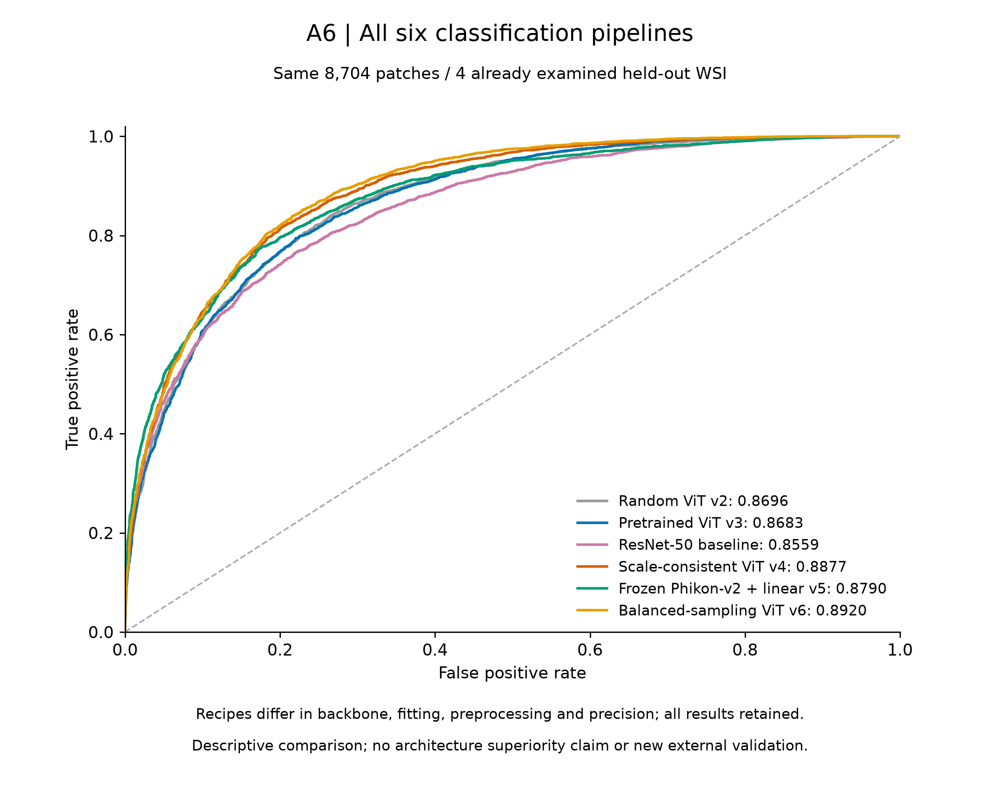
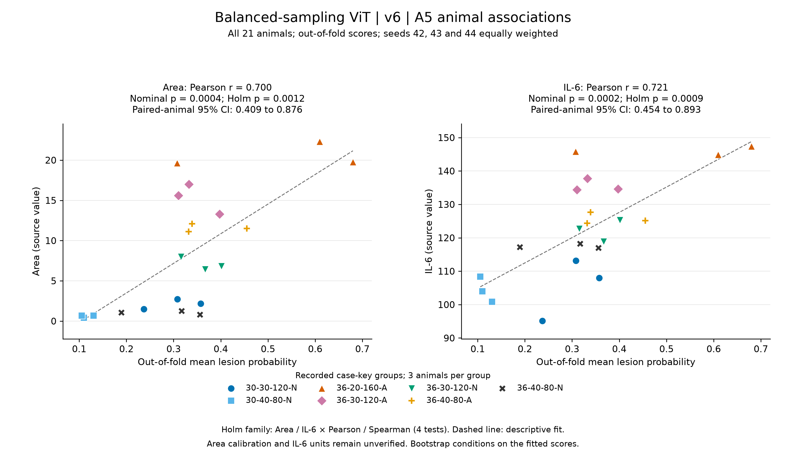

# VisualTransformer: Mouse Lung Histopathology Analysis

Code and numerical results for patch classification and animal-level pathological injury scoring of mouse lung H&E whole-slide images in a heat and ozone co-exposure study.

[中文说明](docs/README_zh.md) · [Methods & Limitations](docs/METHODS_AND_LIMITATIONS.md) · [Patch Generation](docs/PATCH_GENERATION.md) · [Reproducibility](docs/REPRODUCING.md) · [Data](data/README.md) · [Results](results/README.md)

## Overview

The primary model (`v6`) fine-tunes an ImageNet-pretrained ViT-B/16 backbone with class- and source-balanced sampling at a consistent physical field of view. Whole-slide animal scores are computed by averaging predicted lesion probabilities over fixed tissue windows using source-aware three-fold cross-fitting and an equal-weight ensemble across three random seeds.

Key components of the evaluation:

- **Patch classification (`a6`)**: 23,309 training, 7,909 validation, and 8,704 test patches from 19, 5, and 4 source slides, respectively (strictly source-separated).
- **Animal-level scoring (`a5`)**: 21 animals across 7 experimental groups, evaluated over 132,032 fixed whole-slide window locations.
- **Model benchmarks**: five pathology configurations (`v2`–`v6`) alongside a ResNet-50 baseline.

## Summary of Results

| Model configuration | Test AUC | 95% Source-Cluster Bootstrap CI |
|---|---:|---:|
| Random-initialized ViT (`v2`) | 0.870 | [0.815, 0.931] |
| ImageNet-pretrained ViT (`v3`) | 0.868 | [0.826, 0.924] |
| Scale-consistent ViT (`v4`) | 0.888 | [0.830, 0.943] |
| Frozen Phikon-v2 + linear head (`v5`) | 0.879 | [0.772, 0.947] |
| **Scale-consistent ViT + balanced sampling (`v6`)** | **0.892** | **[0.848, 0.946]** |
| ResNet-50 baseline | 0.856 | [0.780, 0.931] |

For animal-level scoring (`n = 21`), `v6` shows strong positive correlations with both recorded lesion area (`r = 0.700`, Holm-adjusted `p = 0.0012`) and IL-6 (`r = 0.721`, Holm-adjusted `p = 0.0009`). Full-precision metrics, Spearman estimates, confidence intervals, and sensitivity analyses are archived in [all_associations_v2_v3_v4_v5_v6.csv](results/tables/all_associations_v2_v3_v4_v5_v6.csv).





*Scope note:* Evaluation is performed on 4 held-out test slides and 21 animals across 7 exposure groups; pooled animal associations primarily reflect between-group differences. Full study design, statistical diagnostics, and limitations are detailed in [Methods & Limitations](docs/METHODS_AND_LIMITATIONS.md).

## Reproducing the Reported Statistics

Python 3.11+ is required. All reported metrics and bootstrap confidence intervals can be verified on CPU directly from the included prediction tables without original whole-slide images or model checkpoints:

```bash
python -m pip install -r requirements-analysis.txt
python scripts/verify_results.py
python scripts/verify_results.py --full-bootstrap
```

Full model retraining and whole-slide inference additionally require the original slide assets, pretrained weights, and a CUDA-compatible GPU environment. See [Reproducibility](docs/REPRODUCING.md) for end-to-end commands.

## Repository Structure

| Directory | Contents |
|---|---|
| `preprocessing/qupath/` | QuPath patch export script and provenance metadata |
| `rebuild_v6/` | Training, patch evaluation, dense whole-slide inference, animal scoring, and statistics |
| `data/` | Source-aware split manifests, canonical identities, and window coordinates |
| `results/` | Prediction tables, summary CSVs, publication figures (PNG/SVG), and training logs |
| `scripts/` | Data preparation and one-command CPU verification scripts |
| `tests/` | Unit tests for source separation, sampling, and numerical consistency |
| `environment/` | Recorded software and hardware environment |
| `docs/` | Detailed methods, patch generation protocol, and reproducibility guide |

## Data and Model Availability

Split manifests, window coordinates, model predictions, and numerical results are included in this repository. Original whole-slide images and trained checkpoints are available from the study maintainers upon reasonable request. See [Provenance](docs/PROVENANCE.md) for artifact integrity records.

## License

Code in this repository is released under the [Apache License 2.0](LICENSE). Phikon-v2 comparison outputs (`v5`) remain subject to the upstream model license; see [Third-Party Notices](THIRD_PARTY_NOTICES.md) and [Result License Scope](results/LICENSE_SCOPE.md).
