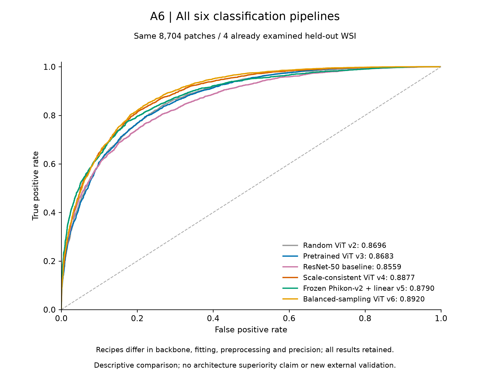
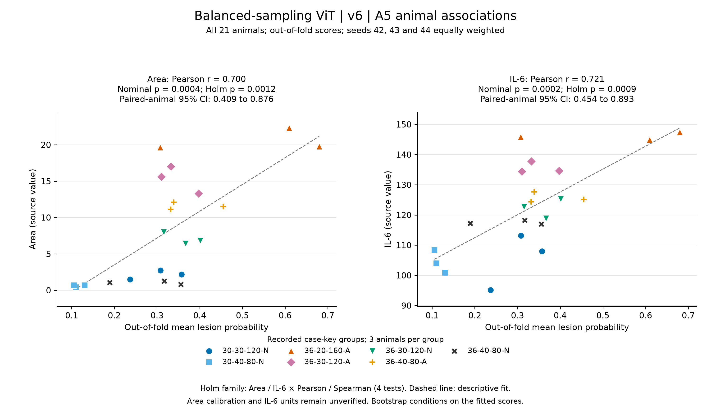

# VisualTransformer: mouse lung histopathology analysis

Code and results for patch classification and animal-level scoring of mouse lung H&E whole-slide images in a heat and ozone co-exposure study.

[中文说明](docs/README_zh.md) · [Methods](docs/METHODS_AND_LIMITATIONS.md) · [Reproducibility](docs/REPRODUCING.md) · [Data](data/README.md) · [Results](results/README.md)

## Overview

The implemented model (v6) fine-tunes an ImageNet-pretrained ViT-B/16 using class- and source-balanced sampling. Animal scores are obtained by averaging lesion probabilities over fixed whole-slide windows, with source-aware cross-fitting and an equal-weight average over three seeds.

The analysis includes:

- Patch classification: 23,309 training, 7,909 validation and 8,704 test patches from 19, 5 and 4 source slides, respectively.
- Animal-level associations: 21 animals in seven experimental groups, using 132,032 fixed window locations.
- Model comparisons: five pathology model configurations and a ResNet-50 classification baseline.

## Results

| Model configuration | Test AUC | 95% source-cluster bootstrap interval |
|---|---:|---:|
| Random-initialized ViT (v2) | 0.869556 | [0.814904, 0.931134] |
| ImageNet-pretrained ViT (v3) | 0.868257 | [0.825655, 0.923752] |
| Scale-consistent ViT (v4) | 0.887736 | [0.829997, 0.943078] |
| Frozen Phikon-v2 with a linear classifier (v5) | 0.878963 | [0.772109, 0.946644] |
| Scale-consistent ViT with balanced sampling (v6) | 0.891999 | [0.848038, 0.946250] |
| ResNet-50 | 0.855901 | [0.779518, 0.930580] |

The v6 animal scores have Pearson correlations of 0.699976 with Area and 0.720957 with IL6 (n = 21). The corresponding Holm-adjusted p-values are 0.001235 and 0.000906. [Complete results](results/tables/all_associations_v2_v3_v4_v5_v6.csv) include all model configurations, Pearson and Spearman estimates, confidence intervals and sensitivity analyses.





These comparisons are exploratory: configurations were evaluated on the same test sources, and v6 was selected for presentation after results were examined. Their numerical ordering does not establish superiority on an independent cohort. Correlations are primarily across experimental groups; within-group-centered correlations for v6 are 0.054569 and 0.173181. Further interpretation and sample-size limitations are described in [Methods](docs/METHODS_AND_LIMITATIONS.md).

## Reproduce the reported statistics

Python 3.11 or later is required. The included predictions support CPU-only verification without image assets or model weights.

```bash
python -m pip install -r requirements-analysis.txt
python scripts/verify_results.py
python scripts/verify_results.py --full-bootstrap
```

Training and image inference additionally require the study image assets, pretrained initialization and a compatible CUDA environment. Installation and command-line examples are provided in [Reproducibility](docs/REPRODUCING.md).

## Repository structure

| Directory | Purpose |
|---|---|
| `rebuild_v6/` | Training, classification evaluation, whole-slide inference, scoring and statistics |
| `data/` | Fixed split manifests, source identities and window coordinates |
| `results/` | Predictions, numerical results, figures and training histories |
| `scripts/` | Data preparation and numerical verification |
| `tests/` | Software tests for identity separation, sampling and numerical equivalence |
| `environment/` | Recorded computational environment |
| `docs/` | Methods, reproducibility and model attribution |

The file-name identifiers `a6` and `a5` denote patch classification and cross-fitted animal scoring, respectively. Version identifiers v2–v6 refer to the model configurations reported above.

## Data and model availability

Split metadata, coordinates, predictions and summary results are included. Original study images and trained model checkpoints are not hosted in this repository. Access requests should be directed to the repository maintainers. The software distribution and the implementation used to generate the reported results are distinguished in [Implementation provenance](docs/PROVENANCE.md).

## License

Repository code is provided under the [Apache License 2.0](LICENSE). Phikon-derived comparison results are subject to the upstream model license, as specified in [Third-party notices](THIRD_PARTY_NOTICES.md) and [Result license scope](results/LICENSE_SCOPE.md).
